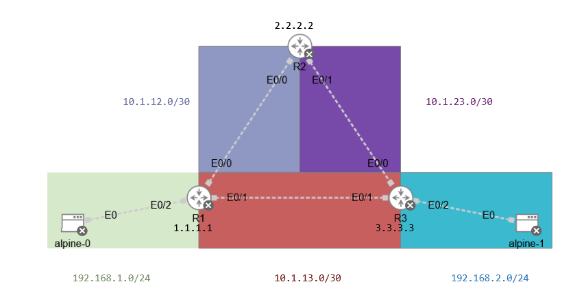

# Lab 2: Single-Area OSPF

## Goal

Configure single-area OSPF across three routers.

## Topology



## Addressing Table

### Router interfaces

| Device | Interface | Connects To | Address |
|--------|-----------|-------------|---------|
| R1 | e0/0 | R2 e0/0 | 10.1.12.1/30 |
| R1 | e0/1 | R3 e0/1 | 10.1.13.1/30 |
| R1 | e0/2 | alpine-0 | 192.168.1.1/24 |
| R1 | Loopback0 | n/a | 1.1.1.1/32 |
| R2 | e0/0 | R1 e0/0 | 10.1.12.2/30 |
| R2 | e0/1 | R3 e0/0 | 10.1.23.1/30 |
| R2 | Loopback0 | n/a | 2.2.2.2/32 |
| R3 | e0/0 | R2 e0/1 | 10.1.23.2/30 |
| R3 | e0/1 | R1 e0/1 | 10.1.13.2/30 |
| R3 | e0/2 | alpine-1 | 192.168.2.1/24 |
| R3 | Loopback0 | n/a | 3.3.3.3/32 |

### Hosts

| Host | Address | Gateway |
|------|---------|---------|
| alpine-0 | 192.168.1.10/24 | 192.168.1.1 |
| alpine-1 | 192.168.2.10/24 | 192.168.2.1 |

## Requirements

CML Free

## How to Use

Import topology.yaml into CML, set up the static addresses for alpine-0 and alpine-1 as shown and start the lab.

```
# alpine-0
sudo ip addr add 192.168.1.10/24 dev eth0
sudo ip route add default via 192.168.1.1

# alpine-1
sudo ip addr add 192.168.2.10/24 dev eth0
sudo ip route add default via 192.168.2.1
```

## Verification

Run on each router:

```
show ip ospf neighbor
show ip route ospf
show ip ospf interface brief
```

Expected results:

| Check | Expected |
|-------|----------|
| Neighbors on each router | 2, both in FULL state |
| R1 route table | Learns 192.168.2.0/24 and the other loopbacks via OSPF |
| alpine-0 to alpine-1 (192.168.2.10) | Ping succeeds |
| Path from alpine-0 to alpine-1 | alpine-0, R1, R3, alpine-1 |

## Experiments performed

### 1. Failover through R2

1. From alpine-0, run `traceroute 192.168.2.10` and note the path.
2. On R1, run `interface Ethernet0/1` then `shutdown`.
3. Run the traceroute again. Traffic should reroute through R2.
4. Run `no shutdown` to restore the link.

### 2. Changing the OSPF cost

1. On R1, set a high cost on the direct link:

```
interface Ethernet0/1
 ip ospf cost 100
```

2. Check `show ip route ospf` and traceroute again. The path should shift to R2 even though no link is down.
3. Revert it so OSPF goes back to automatic costs:

```
interface Ethernet0/1
 no ip ospf cost
```